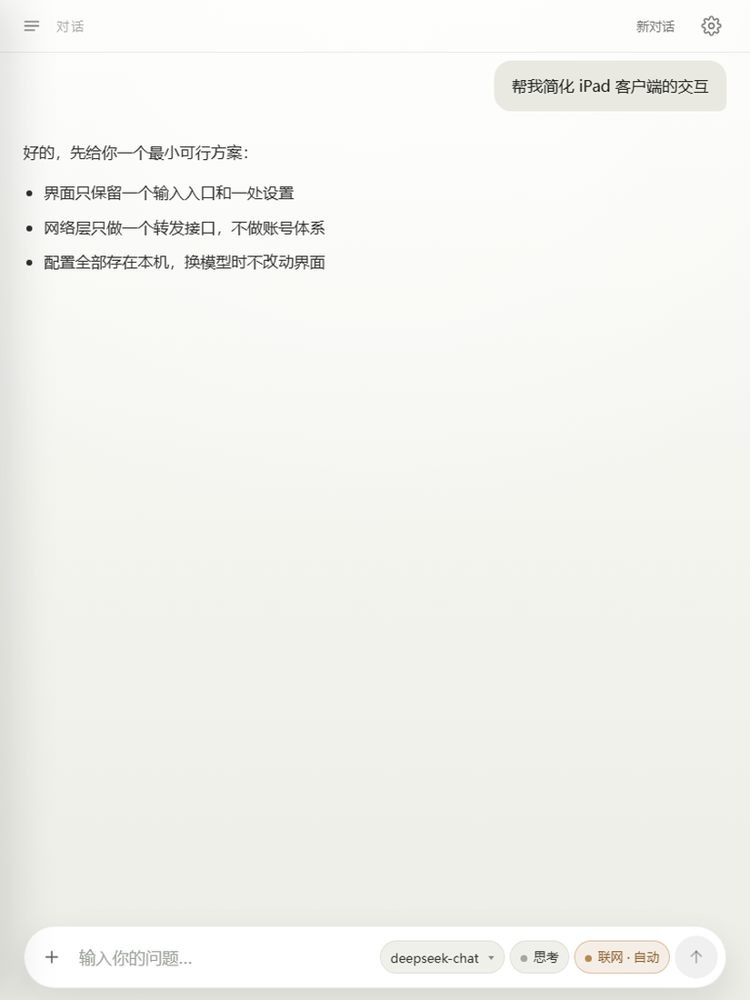
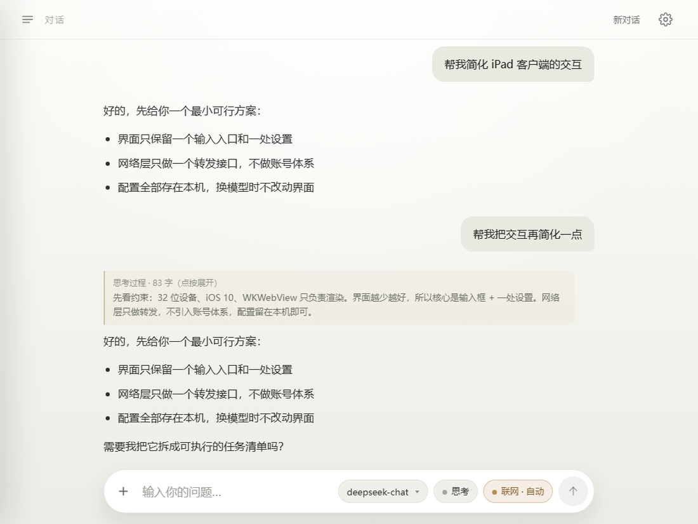
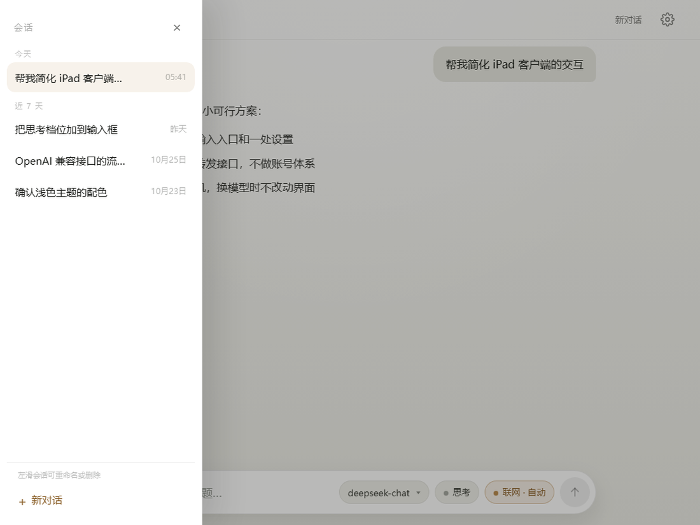
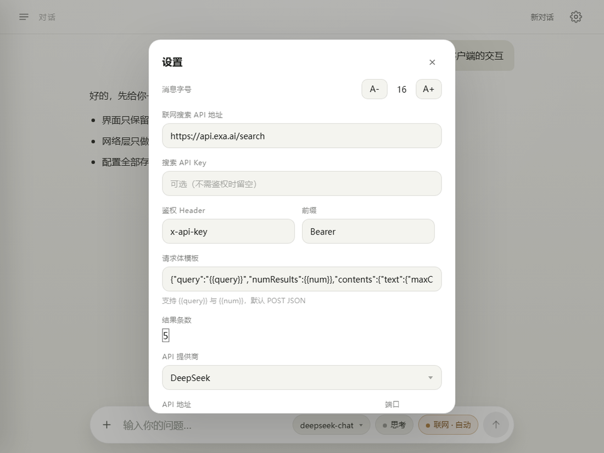
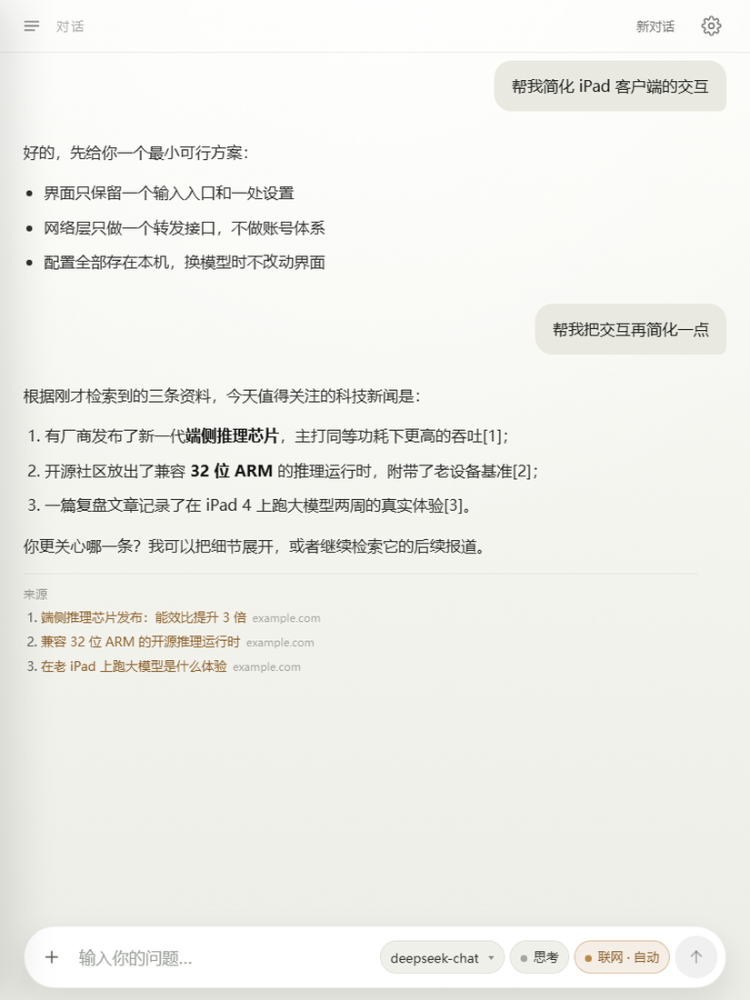
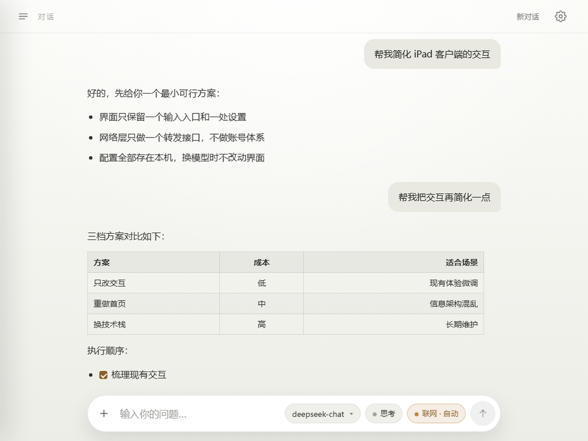
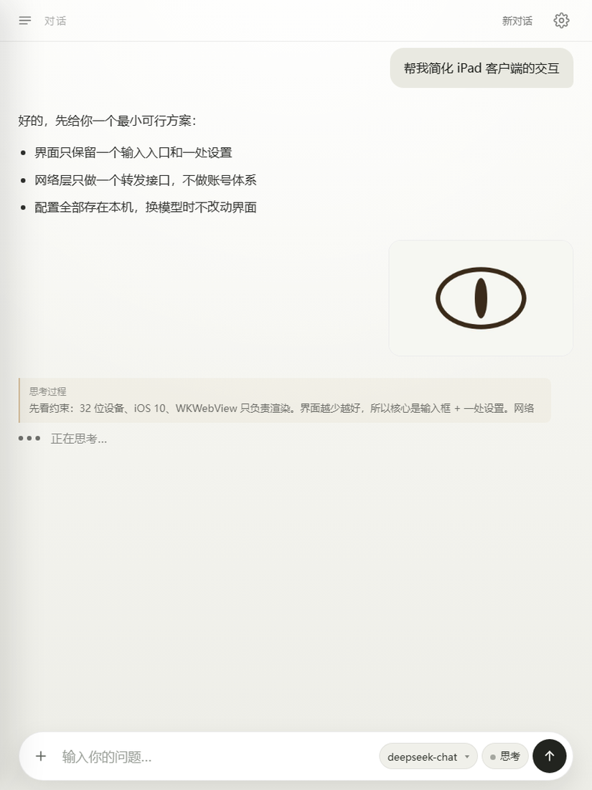

# iLegacyGPT

<p align="center"></p>


面向旧版 iOS 设备的对话客户端，可连接任意 OpenAI 兼容接口。
无账号、无遥测、无服务端组件；API Key 仅保存在设备本地。

`Objective-C + TypeScript` · `MIT` · [](../../releases)

[English](README.md)

## 兼容性

| 项目 | 值 |
| --- | --- |
| 验证设备 | iPad 4（iPad3,4，A6X，armv7），iOS 10.3.4 |
| 最低系统 | 9.3 |
| 架构 | armv7、arm64 |
| 安装方式 | 未签名 IPA，需 AppSync Unified 或自行签名 |

| 平台 | 状态 |
| --- | --- |
| iPad 4（armv7），iOS 10.3.4 | 已验证 |
| armv7，iOS 9.3.5 / 9.3.6：iPad 2、iPad 3、iPhone 4S、iPod touch 5 | 未验证 |
| arm64，iOS 9 / 10：iPhone 5s 至 iPhone 7 | 未验证 |
| iOS 11 及以上 | 未验证 |
| iOS 9.3 以下 | 不支持 |

## 安装

1. 在设备上安装 **AppSync Unified**，或准备签名工具。
2. 从 [Releases](../../releases) 下载 IPA。
3. 使用爱思助手、ipatool 或任意签名工具安装。
4. 打开应用，进入设置，填写 provider、Base URL、端口与 API Key。
5. 刷新模型列表并选择模型。

## 配置

- **接口**：任意 OpenAI 兼容 API。Base URL、端口与 Key 保存在应用沙盒内。
- **思考档位**：关闭、低、中、高。以 `reasoning_effort` 下发；Qwen 系端点使用 `enable_thinking` 与 `thinking_budget`。
- **联网搜索**：关闭、自动、强制。
  - `auto` 注册 `web_search` 工具，由模型决定是否调用。
  - `force` 在首次请求前执行检索。
  - 检索结果以带编号的来源列表附加在回答后，可点开链接。
- **字号**：在设置中调整，保存在设备本地。

## 功能

- 流式输出，思考过程可展开。
- 联网搜索使用真实 function calling；网关拒绝 `tools` 时降级为查询规划器。
- Markdown 渲染：表格（支持列对齐）、任务列表、嵌套列表、删除线、链接、代码块。
- 会话归档按今天、近 7 天、更早分组，支持重命名与删除。
- 支持从相册发送图片，历史记录保留 320px 缩略图。
- 每次请求附带当前时间与时区。
- 界面打包为单个自包含 HTML 文件；UI 为 ES5，不使用 iOS 9/10 缺失的 WebKit 特性。

## 截图

| 首屏 | 对话与思考过程 | 会话抽屉 | 设置 |
| --- | --- | --- | --- |
|  |  |  |  |

| 联网搜索与来源列表 | Markdown 表格与任务列表 | 图片发送 |
| --- | --- | --- |
|  |  |  |

## 从源码构建

工具链：WSL（Ubuntu 22.04）、Theos、iPhoneOS 10.3 SDK。参见 [docs/build-wsl.zh-CN.md](docs/build-wsl.zh-CN.md)。

```bash
cd web && node build.mjs   # TypeScript -> ES5 bundle -> ios/Resources/web/index.html
npx tsc --noEmit           # 类型检查
NAME=iLegacyGPT VERSION=x.y.z bash tools/build_local.sh
```

产物为 `dist/iLegacyGPT-<version>.ipa`，同时包含 armv7 与 arm64 两份切片。

## 目录结构

| 路径 | 内容 |
| --- | --- |
| `ios/ChatAI/` | 应用源码：窗口、WebView 桥、流式客户端、存储 |
| `ios/Resources/web/index.html` | 生成的界面产物，CSS 与 JS 已内联 |
| `web/src/` | TypeScript 与 CSS 源码 |
| `web/build.mjs` | 打包流程：先由 `tsc` 输出 ES5，再由 esbuild 打包并内联 |
| `web/_preview/` | 本地截图工具 |
| `tools/` | 构建、打包与发布脚本 |
| `docs/` | 协议说明、构建说明、发布说明、图片 |

## 隐私与安全

除发送给用户自行配置的接口外，应用不向外部传输任何数据。
参见 [PRIVACY.zh-CN.md](PRIVACY.zh-CN.md) 与 [SECURITY.zh-CN.md](SECURITY.zh-CN.md)。

## 许可

MIT。与 OpenAI 无关联；`GPT` 指代通用大语言模型。
本项目不包含 API Key 与代理服务，按原样提供。